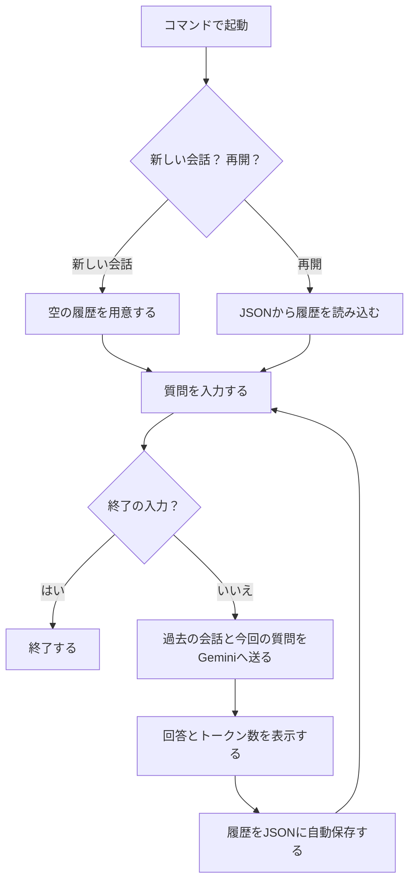

# 第1回 解答

## 演習

- 講座に固有の質問（宿題の3レベル）へのモデルの回答（要約でよい）：
- 用語集の正しい意味と比べて気づいたこと：
- 表示できたトークン数（入力 / 出力）：

## 宿題

### 基礎編

**課題内容：** 同じ質問を、モデルまたはtemperatureを変えて各条件3回ずつ実行し、回答の違いを比較してまとめる。

#### 実験条件

- 取り組んだレベル：基礎（モデルを変えて回答を比較）
- 実行日：2026年10月24日（日本時間）
- 質問文：`LoRAとは何ですか？`
- 比較したモデル：`gemini-3.5-flash-lite`、`gemini-3.1-flash-lite`、`gemini-3.8-flash`
- 実行回数：3.5 Flash-Liteと3.1 Flash-Liteは各3回、3.8 Flashは追加実行を含めて計5回実行した。
- 取得した回答：各モデルで3件ずつ、計9件。全11回の試行のうち、3.8 Flashの最初の2回は120秒の待機上限で終了した。
- 条件：質問文は全回同じにし、temperatureは指定しなかった。毎回プログラムを起動し、会話履歴は渡していない。
- 実行と記録：Codexに実行・ログ保存・回答の要約を依頼した。以下の要約と比較は取得したログに基づく整理である。

使用したコマンドは以下のとおり。3.5 Flash-Liteと3.1 Flash-Liteは各3回、3.8 Flashは計5回実行した。

```bash
AIE_MODEL=gemini-3.5-flash-lite uv run python -m app.ask "LoRAとは何ですか？"
AIE_MODEL=gemini-3.1-flash-lite uv run python -m app.ask "LoRAとは何ですか？"
AIE_MODEL=gemini-3.8-flash uv run python -m app.ask "LoRAとは何ですか？"
```

#### 実行結果

以下はモデルの回答の要約であり、各回答中の技術的な主張の正確性を検証した結果ではない。トークン数はAPIの応答に含まれる `prompt_token_count` と `candidates_token_count` を記録した。

表の「試行」は失敗も含めた実行順を表す。3.8 Flashは3〜5回目の回答を比較に使い、最初の2回のタイムアウトは後述した。

| モデル | 試行 | 入力トークン数 | 出力トークン数 | 回答の要約 |
|---|---|---:|---:|---|
| gemini-3.5-flash-lite | 1 | 7 | 663 | 元のモデルを固定し、小さな追加パラメータを学習して効率よく調整する技術と説明。メモ用紙のたとえを使い、計算資源・保存容量の削減、画像生成やLLMでの利用を紹介した。 |
| gemini-3.5-flash-lite | 2 | 7 | 688 | 追加学習のコスト・時間・容量の問題から説明を始め、元モデルを固定して追加パラメータだけを学習すると説明。LoRAの付け替えや、キャラクター・口調などの調整例を挙げた。 |
| gemini-3.5-flash-lite | 3 | 7 | 577 | モデル全体の更新とLoRAを対比し、元モデルを辞書、追加パラメータを付箋にたとえた。省メモリ・軽量な保存・切り替えを利点として挙げ、画像生成とLLMの用途を説明した。 |
| gemini-3.1-flash-lite | 1 | 7 | 610 | 元モデルを固定し、追加した小さな行列だけを学習する手順を説明。修正パーツのたとえを使い、画像生成でキャラクターや画風を調整する例を詳しく紹介した。 |
| gemini-3.1-flash-lite | 2 | 7 | 758 | 全パラメータを更新する方法と対比し、小さな行列や追加の層を学習するイメージを説明。使用するGPUの例、複数のLoRAの組み合わせ、キャラクター・画風・衣装などの用途を挙げた。 |
| gemini-3.1-flash-lite | 3 | 7 | 767 | 元モデルを固定し、変化量を付箋にたとえて説明。軽量さ・高速な学習・複数LoRAの組み合わせ・取り外しを利点として挙げ、画像生成と口調・専門知識の調整例を紹介した。 |
| gemini-3.8-flash | 3 | 7 | 800 | AI分野のLoRAを、元モデルを固定して小さな追加行列を学習する技術として説明し、辞書と付箋にたとえた。さらに、同音の通信規格LoRaについても、省電力・長距離通信やセンサー用途を補足した。 |
| gemini-3.8-flash | 4 | 7 | 715 | 元モデルを固定し、差分を2つの小さな行列の掛け算で表して学習すると説明。外付けパーツやカセットにたとえ、保存容量・GPUメモリの削減、LoRAの組み合わせ、画像生成やLLMでの用途を紹介した。 |
| gemini-3.8-flash | 5 | 7 | 768 | 辞書の本体を固定し、付箋を追加するたとえで全パラメータ更新との違いを説明。差分を2つの小さな行列の掛け算で扱う仕組みと、軽量さ・省メモリ・着脱や組み合わせ、画像生成や口調・専門分野の調整例を挙げた。 |

#### 結果の比較

- 共通点：3モデルとも、取得できた各3件の回答に「元のモデルを固定し、追加の小さなパラメータを学習する」という説明を含んでいた。画像生成とLLMでの利用にも触れていた。
- 同じモデル内の違い：質問が同じでも、たとえ話、説明の順序、利用例や具体的な数字が変わった。3.5 Flash-Liteではメモ用紙・付箋・辞書、3.1 Flash-Liteでは修正パーツ・拡張パック・付箋などの表現が使われた。
- モデルを変えたときの違い：今回の3.1 Flash-Liteの1・2回目には、小さな行列についての説明があった。3.5 Flash-Liteは3回とも、モデル本体と追加パラメータの関係を身近なたとえで説明していた。3.8 Flashの4・5回目には、差分を「2つの小さな行列の掛け算」で表す説明があった。
- 3.8 Flash内の違い：3回目はAI技術に加えて通信規格のLoRaも補足したが、4・5回目はAI分野のLoRAに絞って説明した。同じモデルでも、回答が扱う範囲やたとえ話が変わった。
- 回答の長さ：取得できた全9件の入力は7トークンだった。出力は3.5 Flash-Liteが577〜688トークン、3.1 Flash-Liteが610〜767トークン、3.8 Flashが715〜800トークンだった。今回は3.8 Flashの出力が3.5 Flash-Liteより長かったが、長さだけで正確さや説明の質は判断できない。
- 正確性の確認が必要な点：3.5 Flash-Liteの回答では、LoRAファイルの容量が1・3回目は「数MB〜数十MB」、2回目は「数十MB〜数百MB」と表現されていた。条件が示されていない具体的な数値は、回答だけで確定せず別途確認が必要である。

#### 自分の気づき・疑問

3.8 flashでは最初2回ともタイムアウトをしてしまい、再度実行したところ中身を確認することができた。
各モデルごとの平均のトークンは、モデルが高くなるにつれ上がっていたが、下のモデルの方が上のモデルのトークン量を上回ることもあった。
普段何気にAIを使っているが、同じ質問を何回もしないため、詳しさが質問ごとに異なることが驚きだった。毎回同じような出力を得るためにきちんとしたプロンプトの質問をするべきだと感じた。
今回は、実行のメモから比較をする文書作成を依頼し、自分がその結果を確認するという方法で行った。AIをうまく使えるか使えないかで宿題を何分で終わらせるかに響いてくることが感じた。


#### タイムアウトの記録とログの保存先

当初は `gemini-3.8-flash` を比較相手として試したが、最初の2回は120秒以内に処理が完了しなかったため、教材のREADMEで代替モデルとして案内されている `gemini-3.1-flash-lite` でも3件の回答を取得した。その後、3.8 Flashの3回目が成功し、さらに4・5回目も成功したため、最終的には3モデルの回答を各3件ずつ比較した。

| モデル | 回 | 実行状況 | 入力トークン数 | 出力トークン数 | 回答の要約・記録 |
|---|---|---|---:|---:|---|
| gemini-3.8-flash | 1 | タイムアウト | 未取得 | 未取得 | 120秒の待機上限で終了。回答を取得できなかった。 |
| gemini-3.8-flash | 2 | タイムアウト | 未取得 | 未取得 | 120秒の待機上限で終了。回答を取得できなかった。 |

タイムアウトは実験用の実行処理が設定した待機上限によるもので、APIがレート制限や混雑のエラーを返したことを確認したわけではない。原因は特定できていない。

120秒（2分）は、uvやPythonの起動を含む実行全体に対してこちらで設定した上限であり、Gemini側の応答時間の上限ではない。待機上限が短かった可能性もあり、さらに待てば回答を取得できた可能性はある。ただし、待機上限を延ばす追加実験は行っていないため、実際に何秒で回答が返ったか、より長く待てば成功したかは分からない。今回の記録から言えるのは「最初の2回は、設定した120秒の上限までに回答を取得できなかった」ということである。

また、基礎編の質問は `LoRAとは何ですか？` のみで回答の長さを指定しておらず、発展編では100字程度または500字程度の説明を求めている。質問条件が異なるため、発展編の応答時間だけから基礎編の所要時間やタイムアウトの原因を判断することはできない。

回答全文・実行コマンド・実行開始時刻・終了コード・トークン数は、[基礎編の実行ログ](learning_log/basic/execution.log) にまとめた。全11回分（回答取得9回、タイムアウト2回）の記録を実行開始時刻順に並べ、モデル名と試行番号で区切っている。

保存先は `lectures/01/learning_log/basic/execution.log`。このファイルは `.gitignore` の除外対象から外しており、`answer.md` とともに提出する。要約はこの解答ファイル、実行内容と回答全文は統合ログで確認できる。

### 実装編

**課題内容：** `app/ask.py` を改修し、会話履歴を保ったまま続けて質問できるようにする。

今回は追加で、会話の自動保存・再開も実装した。

#### 目的

`app/ask.py` に、会話履歴を保ったまま続けて質問できる会話モードを追加する。さらに、回答ごとに履歴を自動保存し、プログラムを終了したあとも会話を再開できるようにする。

仕様は相談して決め、実装・テスト・実際のAPIでの動作確認・結果の整理はCodexに依頼した。

#### 処理の全体像

会話モードの正常時の流れを以下に示す。起動時に新しい会話か再開かを選び、その後は質問・回答・自動保存を繰り返す。



実行中の履歴はメモリ上で保持し、回答ごとにJSONファイルにも保存する。終了後はJSONから履歴を読み戻して再開する。空行やエラー時の処理は図では省略した。

#### 変更内容

| ファイル | 変更内容と理由 |
|---|---|
| `app/ask.py` | `--chat` で入力を繰り返し受け付ける。Gemini SDKの `client.chats.create()` と `chat.send_message()` を使い、以前の質問・回答を次の質問と一緒に送る。回答ごとにトークン数を表示し、履歴を自動保存する。`--resume` で保存した会話を読み込む。 |
| `app/chat_history.py` | 保存先の作成、JSON形式での保存・読み込みを担当する。履歴にはモデル名と、質問・回答を含むSDKの履歴を保存する。文章以外の情報も残し、再開時に復元する。書き込みは一時ファイルを完成させてから置き換え、途中で失敗しても前回の保存内容を残す。 |
| `tests/test_ask.py` | 会話の継続・自動保存・再開・エラー時の動作を、API通信を差し替えて確認する。 |
| `README.md`、`.gitignore` | 使い方を追記した。普段の会話ファイルはGitの対象外にし、提出用の実行ログとサンプル履歴だけを対象にした。 |

会話を覚えているように見えるのは、プログラムが履歴を保持し、SDKを通して毎回APIに渡しているためである。終了するとメモリ上の履歴は消えるが、JSONファイルから読み直せば次の起動でも続きを送れる。APIキーは履歴ファイルに保存しない。

#### 使い方

新しい会話を始める。

```bash
uv run python -m app.ask --chat
```

`あなた>` に質問を入力する。空行は送信しない。`/exit`、Ctrl+C、Ctrl+Dで終了する。回答ごとに `lectures/01/learning_log/sessions/` のJSONファイルへ自動保存される。保存先は起動時と保存時に表示される。回答を得る前に終了した場合はファイルを作らない。

会話を再開する。下のファイル名は例なので、実際に表示された保存先に置き換える。

```bash
uv run python -m app.ask --chat --resume lectures/01/learning_log/sessions/chat-日時-識別子.json
```

再開時には、保存したモデル名と会話履歴を読み込み、同じファイルへの自動保存を続ける。現在の `AIE_MODEL` より保存済みのモデル名を優先する。過去の回答全文は画面に再表示せず、読み込んだ会話の往復数を表示する。

従来の1回だけ質問するコマンドも使える。`--chat` を付けない場合は、回答とトークン数を表示して終了し、会話履歴は保存しない。

```bash
uv run python -m app.ask "LoRAとは何ですか？"
```

#### 動作確認

2026年10月24日（日本時間）に、`gemini-3.5-flash-lite` で確認した。新しい会話で2往復したあとに `/exit` で終了し、別プロセスから `--resume` で再開して1往復した。2つのプロセスの終了コードは、いずれも0だった。

| 段階 | 入力した内容 | 実際の回答の要約 | 入力 / 出力トークン数 |
|---|---|---|---|
| 新規・1往復目 | これから会話の動作確認をします。私のニックネームは「そらまめ」です。短く返事をしてください。 | 「そらまめさん」と呼びかけ、了解したと回答した。 | 28 / 14 |
| 新規・2往復目 | 私のニックネームは何ですか？一文で答えてください。 | 「そらまめ」だと回答した。 | 58 / 14 |
| 終了後に再開・3往復目 | 前の会話で伝えた私のニックネームは何ですか？一文で答えてください。 | 再開前に伝えたニックネームが「そらまめ」だと回答した。 | 93 / 19 |

会話中の前の発言を使って回答でき、終了後も履歴ファイルから会話を続けられた。保存されたJSONには、質問と回答が3往復分（6件）入っている。今回の入力トークン数は28→58→93と増えた。入力には現在の質問に加えて過去の質問・回答も含まれるため、会話が長くなると送る情報も増える。

自動テストは `uv run pytest -q` で実行し、既存分を含む27件すべてが成功した。API通信を使わず、回答ごとの保存、再開時の履歴とモデルの引き継ぎ、空行と終了操作、APIエラー後の再入力、不正な履歴ファイル、保存失敗時に前回のファイルを残す動作などを確認した。

回答全文・実行コマンド・実行開始時刻と終了時刻・終了コード・トークン数は、[実装編の実行ログ](learning_log/implementation/execution.log) にまとめた。自動保存された履歴をそのままコピーした[サンプル履歴](learning_log/implementation/sample-session.json)も提出用に残した。このサンプルから試す場合は、次のコマンドで再開できる（回答後はサンプル自体も更新される）。

```bash
uv run python -m app.ask --chat --resume lectures/01/learning_log/implementation/sample-session.json
```

#### 改善案を考えた流れ（未実装）

実装後にCodexへコードの説明を求め、会話の仕組みを理解したところから、次の改善案を相談した。以下は相談内容の整理であり、改善案の実装や効果の検証はまだ行っていない。

1. **会話を覚える仕組みを確認した。** `client.chats.create()` で履歴を管理する準備をし、`chat.send_message()` で過去の質問・回答と今回の質問を一緒に送っていると分かった。Gemini側に履歴を保存して呼び出す方式もあるが、現在の実装では自分のPCで履歴を管理している。
2. **その仕組みから課題を考えた。** 毎回履歴を送るため、会話が長くなるほど入力トークン数も増える。動作確認でも28→58→93と増えていたため、これを改善する方法があるか質問した。
3. **送る履歴を絞る案を比較した。** Codexから、直近の会話だけ送る、古い会話を要約する、重要な情報を別のメモに残す、質問に関係する過去の会話を検索する案が挙がった。送る情報を減らすと、以前の発言や細かい条件を引き継げなくなる可能性もある。
4. **履歴の保存場所を変える案を質問した。** 「Geminiに送った側で会話を保存できないか」と質問し、Interactions APIではGemini側に会話を保存して、次回は前回のIDと新しい質問を送れることを確認した。[Google公式資料](https://ai.google.dev/gemini-api/docs/interactions-overview)
5. **通信量とトークン数を区別した。** IDを送る方式ならPCから履歴全文を再送する必要はなくなるが、Geminiが参照する過去の会話までなくなるわけではない。履歴も入力として扱われるため、「送信するデータが短くなる」ことと「入力トークンの負担がなくなる」ことは別だと分かった。[トークンの公式説明](https://ai.google.dev/gemini-api/docs/tokens)

相談で挙がった案を整理すると、次のようになる。

| 改善案 | 期待する効果 | 確認すべき点 |
|---|---|---|
| 直近の会話だけ送る | 入力トークン数を抑える | 古い発言を聞かれたときに答えられるか。往復数だけでは、長い発言による増加を抑えきれない。 |
| 古い会話の要約＋直近の会話を送る | 大まかな流れを残しながら入力を短くする | 要約で情報が抜けないか。要約を作る処理にもトークンが必要になる。 |
| 重要な情報のメモ、または関連する履歴の検索 | 必要な情報を選んで送る | 何を重要とするか、関係する情報を正しく選べるか。 |
| Interactions APIでGemini側に保存する | 履歴全文の再送とPC側の履歴管理の手間を減らす | 呼び出し方の変更、保存期間、トークンの扱いを確認する必要がある。長期間の記録や提出用にはローカル保存も役立つ。 |

今後の検証案として、直近の会話だけ送る方式と、現在の全履歴を送る方式を比較する方法がある。その後、古い会話の要約を組み合わせる方法も考えられる。比較では入力トークン数だけでなく、「昔伝えた名前」「以前決めた条件」などに正しく答えられるかも確認する。保存する履歴は全文を残し、APIに送る部分を選ぶ設計なら、記録を失わずに比較できる。どの案を実装するかはまだ決めていない。

#### 自分の気づき・疑問
自分では「野球を好きです。」と伝え、きちんとそれを覚えてくれているかを試した。教えても内容を知っているか聞いてもきちんと知らないと返してくれることを確認した。自分で実装できているかを試した後は、実際にコードの中身がどうなっているかを調べた。わかりにくい部分はdraw.ioで図にしてくれた。実装している内容としては、今までの会話の履歴を保存して全部送っているだけで突飛なことをやっているわけではないことが理解できた。
最後に今回の実装に改善できるかを試した。こういうことがしたいと言ったら案を出してくレた。大事なのはここが不便だから直したいとか、こうあればいいと思う欲求だと感じた。

### 発展編

**課題内容：** 応答時間とトークン数を計測し、複数のモデルや質問で比較する。無料枠のレート制限との関係も考察する。

#### 目的と計測方法

複数のモデル・質問で応答時間と入力・出力トークン数を計測し、回答の長さや無料枠のレート制限との関係を考える。実装・実行・ログ保存・結果の整理はCodexに依頼した。

`app/ask.py` に `time.perf_counter()` による時間計測を追加した。1回だけ質問する場合と会話モードの両方で、SDKのAPI呼び出し直前から回答を受け取るまでを測る。

```python
started = perf_counter()
response = client.models.generate_content(model=MODEL, contents=question)
elapsed = perf_counter() - started
```

この時間には通信が含まれ、SDKの再試行が有効な設定なら、その待ち時間も含まれる。今回の設定で再試行が有効かどうかは、後述の追加確認で調べた。Pythonやuvの起動、回答の画面表示、履歴や実行ログの保存は含めない。また、ストリーミングで最初の文字が届くまでの時間ではなく、回答全体を受け取るまでの時間である。計測だけでは、通信・サーバー側の待機・生成などの内訳は分からない。

#### 実験条件

- 実行日：2026年10月24日（日本時間）。同じPC・ネットワークで順番に実行した。
- モデル：`gemini-3.5-flash-lite` と `gemini-3.8-flash`。
- 質問：同じLoRAについて、短い説明と詳しい説明を求める2種類。要求する文字数は目安であり、厳密な出力制限ではない。
- 回数：2モデル×2質問×各3回、計12回。試行1の短い説明を両モデル、詳しい説明を両モデルに送り、試行2・3も同じ順で繰り返す。
- 各回で別プロセスを起動し、会話履歴は渡さない。temperatureや出力トークン上限は指定しない。
- 実行の開始間隔は最低15秒とし、並列実行しない。応答に15秒以上かかった場合は、終了後に次を実行する。実験スクリプトでは失敗した試行を自動で再実行しない。
- uvの起動を含む1プロセス全体の待機上限は120秒。これはAPIの応答時間とは別に記録し、上限で停止した場合は終了コード124とする。
- 入力・出力トークン数はAPIが返した `prompt_token_count` と `candidates_token_count` を使う。思考トークンなどを含む総トークン数や請求額を表すものではない。

| 質問の種類 | 実際の質問文 |
|---|---|
| 短い説明 | LoRAとは何ですか？Python初心者向けに100字程度で説明してください。 |
| 詳しい説明 | LoRAとは何ですか？Python初心者向けに、仕組み・利点・具体的な利用例を含めて500字程度で説明してください。 |

再実行用のスクリプトも保存した。

```bash
uv run python scripts/benchmark_ask.py
```

このスクリプトが、モデル名を `AIE_MODEL` で指定して各質問を次の形式で実行する。各回の正確なコマンドは実行ログに記録する。

```bash
AIE_MODEL=gemini-3.5-flash-lite uv run python -m app.ask "LoRAとは何ですか？Python初心者向けに100字程度で説明してください。"
```

#### 実行結果

実行時間帯は13:16〜13:25（日本時間）。全12回で回答を取得でき、終了コードはすべて0だった。プロセス全体の120秒上限で停止した試行はなかった。

| モデル | 質問 | 試行 | 応答時間（秒） | 入力トークン数 | 出力トークン数 |
|---|---|---:|---:|---:|---:|
| gemini-3.5-flash-lite | 短い説明 | 1 | 1.281 | 20 | 55 |
| gemini-3.5-flash-lite | 短い説明 | 2 | 1.164 | 20 | 61 |
| gemini-3.5-flash-lite | 短い説明 | 3 | 1.875 | 20 | 55 |
| gemini-3.5-flash-lite | 詳しい説明 | 1 | 2.318 | 31 | 374 |
| gemini-3.5-flash-lite | 詳しい説明 | 2 | 2.084 | 31 | 355 |
| gemini-3.5-flash-lite | 詳しい説明 | 3 | 1.841 | 31 | 262 |
| gemini-3.8-flash | 短い説明 | 1 | 65.910 | 20 | 63 |
| gemini-3.8-flash | 短い説明 | 2 | 39.528 | 20 | 60 |
| gemini-3.8-flash | 短い説明 | 3 | 76.747 | 20 | 60 |
| gemini-3.8-flash | 詳しい説明 | 1 | 103.432 | 31 | 300 |
| gemini-3.8-flash | 詳しい説明 | 2 | 82.089 | 31 | 280 |
| gemini-3.8-flash | 詳しい説明 | 3 | 81.289 | 31 | 310 |

各条件3回の集計は以下のとおり。平均応答時間は小数点以下3桁、平均出力トークン数は1桁に丸めた。

| モデル | 質問 | 平均応答時間（秒） | 応答時間の範囲（秒） | 平均出力トークン数 |
|---|---|---:|---|---:|
| gemini-3.5-flash-lite | 短い説明 | 1.440 | 1.164〜1.875 | 57.0 |
| gemini-3.5-flash-lite | 詳しい説明 | 2.081 | 1.841〜2.318 | 330.3 |
| gemini-3.8-flash | 短い説明 | 60.728 | 39.528〜76.747 | 61.0 |
| gemini-3.8-flash | 詳しい説明 | 88.937 | 81.289〜103.432 | 296.7 |

短い説明では、両モデルともLoRAをAIの効率的なカスタマイズ・追加学習の技術として短く説明した。詳しい説明では、元のモデルを固定して追加部分を学習する仕組み、省メモリなどの利点、画像生成や文章生成での利用例を説明した。この要約は回答内容の整理であり、回答中の技術的な主張をすべて検証したものではない。

#### 比較して分かったこと

- **質問の違い：** 両モデルとも、詳しい説明では短い説明より出力トークン数と平均応答時間が増えた。短い説明は55〜63トークン、詳しい説明は262〜374トークンだった。ただし、質問の長さと求める内容も同時に変わっており、出力の長さだけの影響を切り分けた実験ではない。
- **モデルの違い：** 今回の条件では3.5 Flash-Liteの方が速かった。3.8 Flashの詳しい説明は平均296.7トークンで、3.5 Flash-Liteの330.3トークンより少なかったが、平均応答時間は長かった。出力トークン数だけでは応答時間を説明できない。
- **同じ条件でも時間が変わる：** 3.8 Flashの短い説明は出力60〜63トークンと近い値だったが、応答時間は39.528〜76.747秒と幅があった。1回だけ測ると、その回の値に強く左右される。
- **比較の限界：** 各条件3回だけの結果であり、モデルの一般的な速さや回答品質を確定するものではない。生成内容の違い、通信やサーバー側の状態などの影響を切り分けていないため、今回の時間差の原因は特定できない。品質を判断するには、速さ・トークン数とは別に内容の確認が必要である。

#### 検証方法の改善案（未実施）

「比較の限界」を踏まえ、より確かな比較にする方法をCodexに質問した。現在の計測でも、この環境で回答全体を受け取るまでの待ち時間は測れている。今後は、目的・条件・回数・評価方法を以下のように整える案がある。以下は検証方法の提案であり、追加の実験や実装は行っていない。

1. **何の速さを測るかを決める。** 現在は回答全体を受け取るまでの時間を測っている。使い始めの待ち時間も比較するなら、回答を少しずつ受け取るストリーミングを使い、最初の回答が届くまでの時間も別に記録する。LLMの性能測定でも、最初の応答までの時間と、回答全体の時間などを分けて扱う。[NVIDIAの性能測定の解説](https://developer.nvidia.com/blog/measuring-generative-ai-model-performance-using-nvidia-genai-perf-and-an-openai-compatible-api/)
2. **比較条件をそろえて記録する。** 同じ質問文・会話履歴・回答形式の指示・送信間隔・同時実行数・PC・ネットワーク・SDKバージョンで比較する。出力上限や思考に関する設定も明記し、モデル間でそろえられない違いは記録する。「100字程度」という指示や出力上限だけでは実際の長さは同じにならないため、実際の入出力トークン数も残す。モデルの幅広い用途を比較したい場合は、LoRAの説明だけでなく、要約・計算・コード作成など、使いたい用途に合う複数の質問を用意する。
3. **回数と時間帯を増やし、実行順を入れ替える。** 例えば各条件を10〜30回程度、複数の時間帯で試す。ただし、この回数なら必ず十分という基準ではなく、ばらつきや必要な精度を見て判断する。モデルA→BだけでなくB→Aの順も用い、片方のモデルだけが特定の実行順や時間帯に偏るのを抑える。実行回数や間隔は利用枠を確認して決める。
4. **平均以外の値と失敗も集計する。** 平均に加え、極端に遅い1回に左右されにくい中央値、最小値・最大値、成功率、タイムアウト件数を示す。タイムアウトした試行も削除せず、待機上限とともに残す。その試行の本当の応答時間は不明なので、上限の秒数を成功時の応答時間として平均に混ぜない。成功した試行だけの平均を出す場合は、その対象と成功率を併記する。
5. **品質は事前に決めた基準で評価する。** 速さやトークン数だけでは品質を判断できないため、正確さ・分かりやすさ・指示への対応などを別に評価する。採点基準は回答を見る前に決め、モデル名を隠して回答A・Bとして比べる方法も考えられる。Googleの評価機能でも、基準に沿った採点や回答同士の比較を扱っている。[Googleの評価資料](https://docs.cloud.google.com/vertex-ai/generative-ai/docs/models/eval-python-sdk/view-evaluation)

LoRAの説明を評価する場合の基準例を以下に示す。これは今後の評価に使う案であり、今回の回答を採点した結果ではない。

| 評価項目 | 確認する内容 |
|---|---|
| 正確さ | 元の重みを固定し、追加パラメータを学習する仕組みを正しく説明しているか。 |
| 分かりやすさ | 初心者に分からない専門用語を説明しているか。 |
| 指示への対応 | 質問で求めた仕組み・利点・具体例を含んでいるか。 |

これらを改善しても、PC側の計測だけで通信・サーバー側の待機・モデル内部の処理時間を完全に分離することはできない。まずは「自分が使う条件で、どれくらい待ち、どれくらい安定して、必要な品質の回答を得られるか」を比較するのが実用的な検証になる。

#### 無料枠のレート制限との関係

Googleの公式資料では、主な制限として1分あたりのリクエスト数（RPM）、1分あたりの入力トークン数（TPM）、1日あたりのリクエスト数（RPD）が説明されている。いずれかの上限を超えると制限の対象になる。上限はAPIキー単位ではなくプロジェクト単位で、モデルや利用枠によって異なる。[公式資料：Rate limits](https://ai.google.dev/gemini-api/docs/rate-limits)

今回の実験では、各実行の開始を最低15秒空け、並列実行しなかった。最終的な実行ログには429エラーはなく、レート制限で終了する試行もなかった。ただし、実際の利用枠や上限値をAI Studioで確認したわけでも、上限まで負荷をかけたわけでもない。この条件で成功したという結果から、無料枠の限界値は判断できない。この12回のログでは、SDK内部の各HTTP送信・応答を記録していない。そこで、再試行設定の確認と、2回だけの追加観測を別途行った。

実験から考えた関係は次のとおり。

- 応答が速くても、そのまま短い間隔で何度も質問するとRPMの上限に近づく。速いモデルなら無制限に連続実行できるという意味ではない。
- 会話モードでは過去の履歴も入力に含まれるため、長い会話では1回あたりの入力トークン数が増え、TPMの上限にも注意が必要になる。今回の履歴なしの質問は20または31トークンだったが、長い会話でも同じ量とは限らない。
- 今回増えた詳しい回答の出力トークン数は、そのまま上記の「入力TPM」の値になるわけではない。ただし、その回答を次の質問の履歴として送れば、次回の入力に含まれる。
- 基礎編のタイムアウトや今回の長い応答時間だけを理由に、レート制限が原因だったとは判断できない。

#### SDKのHTTP応答・再試行の追加確認（2回）

SDKが裏側で再試行していた可能性について質問し、インストール済みのSDKの実装と、実際のHTTP送信・応答を確認した。Codexが実行・記録し、追加の実API呼び出しは2回だけとした。

**再試行設定の確認：** この環境の `google-genai==2.31.0` の `_api_client.py` にある `retry_args()` を確認すると、`retry_options` が `None`（未指定）の場合は、最初の1回だけ試して終了する実装だった。現在の `app/ask.py` もこの設定を指定していない。SDKが自動再試行する可能性を述べた以前の説明は、今回の設定を確認していなかったため、この確認結果で補足・訂正する。

外部APIを使わない模擬通信でも、503エラーの次に成功を返すようにしたところ、再試行設定が未指定の場合は1回の送信で503エラーになった。別途、`HttpRetryOptions(attempts=2)` を明示した模擬通信では、2回送信して成功した。これらは設定の違いを確かめるローカルの確認であり、Geminiへの追加の質問ではない。

**実APIでの観測方法：** `scripts/check_sdk_retries.py` を用意し、SDKが使うHTTPXの送信・応答イベントを記録した。HTTPXの応答イベントは、SDKがHTTPエラーを処理する前の応答も観測できる。[HTTPX公式資料](https://www.python-httpx.org/advanced/event-hooks/)

```bash
uv run python -m scripts.check_sdk_retries
```

モデルは `gemini-3.8-flash`、質問は発展編と同じ「LoRAとは何ですか？Python初心者向けに100字程度で説明してください。」とした。各回で別のclientを作り、会話履歴・temperature・再試行設定は未指定のままにした。HTTPの待機上限は120秒とし、各回の開始間隔は最低15秒とした。HTTPヘッダー、URL、APIキーは保存せず、送信回数・経過時間・HTTPステータスを記録した。

2026年10月24日13:55〜13:57（日本時間）の結果は以下のとおり。

| 試行 | HTTP送信回数 | HTTP応答の順序 | SDK応答時間（秒） | 入力 / 出力トークン数 | 最終結果 |
|---|---:|---|---:|---|---|
| 1 | 1 | 200 | 89.334 | 20 / 58 | 成功 |
| 2 | 1 | 200 | 72.222 | 20 / 56 | 成功 |

200はHTTP通信が成功したことを表す。両方とも1回の送信で回答を取得し、SDKによるHTTPの再試行は観測されなかった。この2回の長い待ち時間は、SDKのHTTP再試行によるものではなかった。ただし、通信・サーバー側の待機・生成時間の内訳までは分からない。また、以前の12回の途中のHTTP応答を後から復元できたわけではなく、今回の2回を追加観測した結果である。

回答全文とHTTPイベントの記録は、同じ発展編フォルダの[追加確認ログ](learning_log/advanced/retry-check.log)に保存した。元の12回分の実行ログと集計結果は変更していない。

#### ログと検証

回答全文・実行コマンド・開始と終了の時刻・終了コード・API応答時間・プロセス全体の時間・トークン数を、[発展編の実行ログ](learning_log/advanced/execution.log)にまとめた。[集計用JSON](learning_log/advanced/results.json)にも全12回分を保存した。両方とも `.gitignore` の除外対象から外しており、提出用に追加できる。

時間計測を追加したあと、`uv run pytest -q` を実行し、既存分を含む27件すべてが成功した。API通信を差し替えたテストでは時計も差し替え、API呼び出しに1.250秒かかった場合に `[応答時間（秒）] 1.250` と表示されることを確認した。実験スクリプトは既存結果がある場合に上書きせず終了する。

#### 自分の気づき・疑問
発展編ということで、Aiに応答時間とトークン数を計測する仕組みをつくらせて調べた。これを調べたいとAiには伝えただけで、どのような条件で調べるかは一切指示をしなかったが、Aiがどのように調べたら比較できるかや、レート制限に抵触しないためにどのように調べればいいかを考えてくれた。自分が指示をしたのは、ファイルが散らかったからまとめて欲しいというフィードバックくらいだった。
